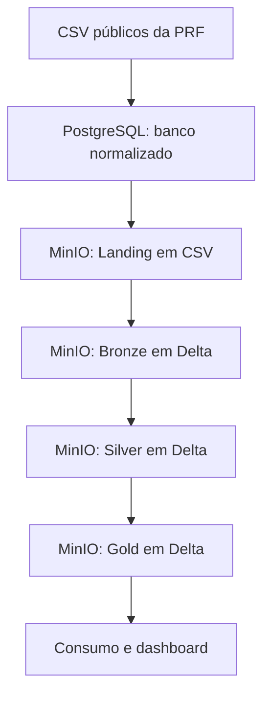

# projeto-ed-final

Projeto final da disciplina de Engenharia de Dados: um ambiente local de dados, montado com Docker, para processar os registros de acidentes nas rodovias federais brasileiras (2023 a 2026, dados da PRF).

## Objetivo

Construir uma pipeline de dados sobre acidentes nas rodovias federais brasileiras, desde a organização dos registros em um banco normalizado até a disponibilização de informações para análise. O projeto busca analisar a ocorrência e a gravidade dos acidentes em diferentes períodos e localidades.

## Fluxo planejado



O Apache Spark será responsável pelo processamento dos dados entre as camadas. O Databricks está previsto para disponibilizar os dados tratados para consumo; a integração com o MinIO está em definição. A ferramenta de orquestração e o agendamento serão documentados após a definição do grupo.

O ambiente junta quatro peças:

- **PostgreSQL:** banco de dados de origem.
- **MinIO:** object storage que faz o papel de data lake.
- **Apache Spark:** cluster com um master e um worker para o processamento.
- **Datasets:** os CSVs de acidentes, já versionados no repositório.

> **Status:** em desenvolvimento. O `docker-compose.yml` configura os serviços, e os scripts SQL de normalização já estão no repositório. O `Dockerfile` e o `requirements.txt` ainda estão vazios, e os jobs de processamento da pipeline serão adicionados nas próximas etapas.

## Estrutura do projeto

```
projeto-ed-final/
├── docker-compose.yml   # PostgreSQL, MinIO, Spark master e Spark worker
├── Dockerfile           # (vazio) imagem própria do projeto
├── requirements.txt     # (vazio) dependências Python
├── .gitignore
├── README.md
├── Datasets/            # CSVs de acidentes da PRF
│   ├── acidentes2023/acidentes2023.csv
│   ├── acidentes2024/acidentes2024.csv
│   ├── acidentes2025/acidentes2025.csv
│   └── acidentes2026/acidentes2026.csv
├── docs/                # Documentação do projeto
│   └── guia_dbeaver_normalizacao.md
├── scripts/             # Montada em /opt/spark-apps; jobs Spark serão adicionados
│   └── sql/             # Scripts de criação, carga e validação do banco normalizado
└── lake/                # (ignorada no git) dados locais, montada em /opt/spark-data
```

Os scripts SQL de criação, carga e validação do banco normalizado estão em `scripts/sql/`. O modelo e as instruções de execução estão no [Guia de normalização e execução no DBeaver](docs/guia_dbeaver_normalizacao.md).

## Serviços

Todos os containers ficam na rede `ed-network` e se enxergam pelo nome do serviço.

| Serviço | Container | Imagem | Portas no host | Para que serve |
|---|---|---|---|---|
| `postgres` | `ed-postgres` | `postgres:16` | `5432` | Banco de origem (`acidentes_origem`) |
| `minio` | `ed-minio` | `soldevelo/minio:2026.7` | `9000` (API S3), `9001` (console) | Data lake |
| `spark-master` | `ed-spark-master` | `apache/spark:3.5.6` | `8080` (UI), `7077` (master) | Coordena o cluster Spark |
| `spark-worker` | `ed-spark-worker` | `apache/spark:3.5.6` | `8081` (UI) | Executa as tarefas (2 cores, 2 GB) |

Volumes:

- **Volumes nomeados:** `postgres_data` e `minio_data`, onde ficam os dados persistidos do banco e do data lake.
- **Pastas do host montadas no master e no worker:** `./scripts` em `/opt/spark-apps` e `./lake` em `/opt/spark-data`.

## Como rodar

### Pré-requisitos

- Docker e Docker Compose v2
- Pelo menos ~4 GB de RAM livres para os containers

### 1. Criar o `.env`

O `.env` está no `.gitignore`, então cada pessoa cria o seu na raiz do projeto:

```env
# PostgreSQL
POSTGRES_DB=acidentes_origem
POSTGRES_USER=ed_user
POSTGRES_PASSWORD=troque_esta_senha

# MinIO (a senha precisa ter pelo menos 8 caracteres)
MINIO_ROOT_USER=minioadmin
MINIO_ROOT_PASSWORD=troque_esta_senha
```

- **`POSTGRES_PASSWORD`:** obrigatória. Sem ela o compose não sobe.
- **`POSTGRES_DB` e `POSTGRES_USER`:** opcionais, os valores padrão são os do exemplo acima.
- **`MINIO_ROOT_USER` e `MINIO_ROOT_PASSWORD`:** não têm valor padrão no compose, então precisam estar no `.env`.

### 2. Subir os serviços

```bash
docker compose up -d
```

```bash
docker compose ps
```

### 3. Acessar

| O quê | Endereço |
|---|---|
| Console do MinIO | http://localhost:9001 (login com `MINIO_ROOT_USER` / `MINIO_ROOT_PASSWORD`) |
| API S3 do MinIO | http://localhost:9000 (`http://minio:9000` de dentro da rede) |
| Spark Master UI | http://localhost:8080 |
| Spark Worker UI | http://localhost:8081 |
| PostgreSQL | `localhost:5432` (`postgres:5432` de dentro da rede) |

### 4. Enviar um job para o Spark

Com um script em `scripts/`, por exemplo `scripts/meu_job.py`:

```bash
docker exec -it ed-spark-master /opt/spark/bin/spark-submit --master spark://spark-master:7077 /opt/spark-apps/meu_job.py
```

### Parar

```bash
docker compose down
```

O comando acima mantém os dados. Para apagar também os volumes do Postgres e do MinIO, use `docker compose down -v`.

## Datasets

Os arquivos em `Datasets/` são os dados abertos de acidentes da PRF agrupados por pessoa: cada linha é **uma pessoa envolvida**, então o mesmo acidente (`id`) aparece em várias linhas.

| Arquivo | Período | Linhas | Acidentes distintos |
|---|---|---:|---:|
| `acidentes2023.csv` | 01/01/2023 a 31/12/2023 | 183.361 | 67.766 |
| `acidentes2024.csv` | 01/01/2024 a 31/12/2024 | 196.448 | 73.202 |
| `acidentes2025.csv` | 01/01/2025 a 31/12/2025 | 194.629 | 72.529 |
| `acidentes2026.csv` | 01/01/2026 a 30/09/2026 | 148.868 | 54.895 |

O arquivo de 2026 vai só até setembro, então o ano está incompleto.

Formato dos arquivos:

- **Separador:** `;`
- **Codificação:** ISO-8859-1 (Latin-1)
- **Quebra de linha:** CRLF
- **Decimais:** vírgula (ex.: `-19,09484877`)
- **Valores ausentes:** `NA` ou `Não Informado`

O campo `tracado_via` pode ter `;` dentro das aspas (ex.: `"Reta;Declive"`), então a leitura precisa respeitar as aspas.

Os quatro arquivos têm as mesmas 35 colunas:

| Grupo | Colunas |
|---|---|
| Identificação | `id`, `pesid`, `id_veiculo` |
| Data e hora | `data_inversa`, `dia_semana`, `horario`, `fase_dia` |
| Localização | `uf`, `br`, `km`, `municipio`, `latitude`, `longitude`, `sentido_via`, `uso_solo` |
| Acidente | `causa_acidente`, `tipo_acidente`, `classificacao_acidente` |
| Via e clima | `condicao_metereologica`, `tipo_pista`, `tracado_via` |
| Veículo | `tipo_veiculo`, `marca`, `ano_fabricacao_veiculo` |
| Pessoa | `tipo_envolvido`, `estado_fisico`, `idade`, `sexo` |
| Vítimas | `ilesos`, `feridos_leves`, `feridos_graves`, `mortos` |
| Órgão da PRF | `regional`, `delegacia`, `uop` |

Leitura no Spark:

```python
df = (spark.read
      .option("header", True)
      .option("sep", ";")
      .option("encoding", "ISO-8859-1")
      .option("quote", '"')
      .csv("/opt/spark-data/acidentes2023.csv"))
```

O caminho acima supõe que o CSV foi copiado para `lake/`, que é a pasta montada em `/opt/spark-data`. A pasta `Datasets/` não é montada nos containers.

## Próximos passos

- [ ] Preencher o `Dockerfile` e o `requirements.txt`
- [ ] Adicionar os jobs Spark à pasta `scripts/`
- [ ] Configurar o Spark para ler e gravar no MinIO (`s3a://`, `hadoop-aws`)
- [ ] Carregar os CSVs no PostgreSQL de origem
- [ ] Adicionar um `.env.example` ao repositório

- [ ] Implementar a extração do banco de origem para a Landing
- [ ] Implementar e validar as camadas Bronze, Silver e Gold em Delta Lake
- [ ] Implementar o histórico das dimensões com SCD tipo 2 e a carga incremental dos fatos
- [ ] Configurar a orquestração e o agendamento da pipeline
- [ ] Definir quatro KPIs e duas métricas e construir o dashboard de uma página
- [ ] Validar a integração dos dados tratados com o Databricks
- [ ] Publicar a documentação com MkDocs Material

## Documentação

O [guia de normalização e execução no DBeaver](docs/guia_dbeaver_normalizacao.md) documenta a preparação do banco de origem. A documentação completa será organizada com MkDocs Material, e o link do site será incluído após a publicação.

## Equipe

- Evandro Luiz
- Guilherme Brognoli
- Guilherme Victor Machado
- Maicou Hahn Fortuna
- Yasmin Bez Fontana

## Referência de organização e documentação

[Modelo disponibilizado pelo professor para README, estrutura de pastas e MkDocs](https://github.com/jlsilva01/projeto-ed-satc).
