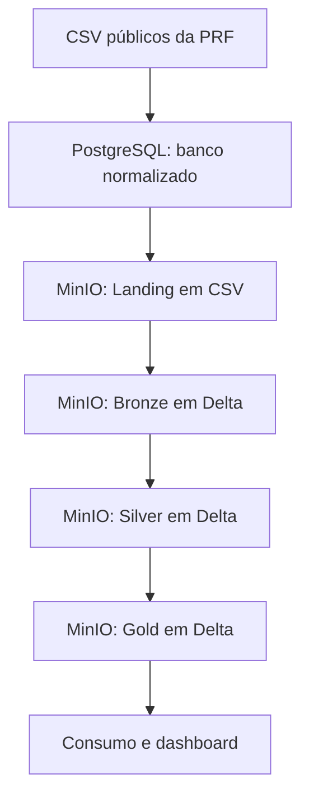

# Arquitetura e pipeline

## Ferramentas e responsabilidades

A configuração Docker do repositório reúne PostgreSQL, MinIO e Apache Spark.

| Componente | Papel no projeto |
|---|---|
| Docker e Docker Compose | Executar e organizar os serviços em containers |
| PostgreSQL | Armazenar o banco de origem normalizado |
| MinIO | Armazenar os arquivos e as camadas do Data Lake |
| Apache Spark | Processar os dados entre as camadas |
| Delta Lake | Formato planejado para as tabelas Bronze, Silver e Gold |
| Databricks | Previsto para disponibilizar os dados tratados para consumo |

A integração entre o MinIO e o Databricks está em definição. A ferramenta de orquestração e o agendamento serão documentados após a definição do grupo.

## Fluxo planejado

O diagrama apresenta o fluxo pretendido. As etapas de ingestão, tratamento e consumo serão detalhadas conforme a implementação e os testes avançarem.

## Camadas do Data Lake

| Camada | Finalidade planejada |
|---|---|
| Landing | Receber a extração das tabelas do PostgreSQL em CSV |
| Bronze | Preservar os dados da extração em tabelas Delta e registrar metadados de ingestão |
| Silver | Aplicar tipos, padronizações e regras de qualidade |
| Gold | Organizar dimensões e fatos para análise e consumo pelo dashboard |

A importação dos arquivos públicos para o PostgreSQL prepara o banco de origem. A extração desse banco para a Landing é uma etapa posterior da pipeline.

## Próximas definições

A documentação será complementada com:

- Nomes dos buckets, tabelas e caminhos utilizados.
- Regras de qualidade aplicadas na Silver.
- Modelo analítico da Gold.
- Histórico das dimensões com SCD tipo 2 e carga incremental dos fatos.
- Dependências, agendamento e tratamento de falhas da pipeline.
- Quatro KPIs, duas métricas e dashboard de uma página.
- Procedimento completo de execução e evidências dos resultados.

