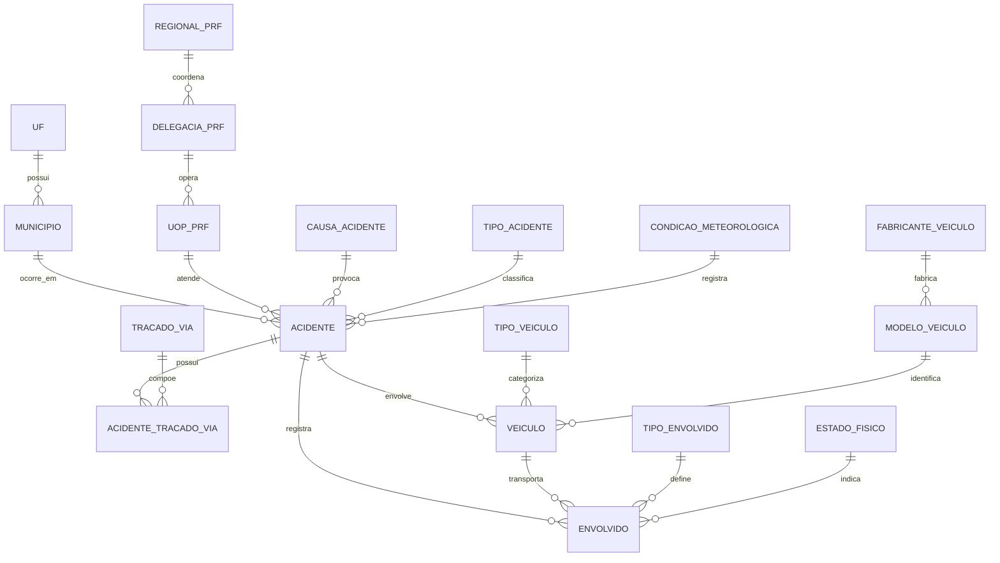

# Guia de Normalização (3FN) e Execução no DBeaver + PostgreSQL

Este guia documenta a normalização dos 4 arquivos CSV dos **Dados Abertos da PRF** (`acidentes2023.csv` a `acidentes2026.csv`, **723.306 linhas totais**, período de **01/01/2023 a 30/09/2026**) para um banco relacional PostgreSQL gerenciado no **DBeaver**, atendendo integralmente aos critérios da **Etapa 2 (Origem dos Dados)** do trabalho final.

## 1. Atendimento aos Critérios do Projeto

| Critério da Etapa 2 | Exigência | Resultado no Modelo (`schema prf`) |
| :--- | :--- | :--- |
| **Ambiente relacional** | Relacional ou não relacional | **PostgreSQL** (gerenciado no DBeaver) |
| **Quantidade de tabelas** | Mínimo de 10 tabelas | **18 tabelas normalizadas em 3FN** (4 principais/associativa + 14 de domínio/hierarquia) |
| **Volume por tabela principal** | Mínimo de 10.000 linhas | `acidente`: **268.392**, `acidente_tracado_via`: **344.682**, `veiculo`: **515.106**, `envolvido`: **659.445** |
| **Distribuição temporal** | Últimos 3 anos | **2023-01-01 a 2026-09-30** (4 anos civis consecutivos) |

## 2. Justificativa da Normalização (1FN → 2FN → 3FN)

Os CSVs originais possuem **35 colunas desnormalizadas (0FN/1FN)** com granularidade mista (repetindo dados do acidente e do veículo para cada pessoa envolvida).

### Primeira Forma Normal (1FN — Atomicidade)
- **Problema encontrado:** A coluna `tracado_via` armazena múltiplos valores concatenados por ponto e vírgula (ex.: `Reta;Declive`, `Curva;Aclive`), gerando **1.181 combinações distintas**.
- **Solução aplicada:** Separação em `prf.tracado_via` (**12 valores atômicos**) e tabela associativa N:N `prf.acidente_tracado_via` (**344.682 registros**).

### Segunda Forma Normal (2FN — Eliminação de Dependências Parciais)
- **Problema encontrado:** Na tabela plana, atributos do acidente (`data_inversa`, `municipio`, `causa_acidente`...), do veículo (`tipo_veiculo`, `marca`, `ano_fabricacao_veiculo`) e da pessoa (`tipo_envolvido`, `estado_fisico`, `idade`, `sexo`) ficavam misturados na mesma linha.
- **Solução aplicada:** Decomposição em 3 entidades principais com chaves primárias próprias:
  - `prf.acidente` (`id_acidente` — **268.392** registros)
  - `prf.veiculo` (`id_veiculo` — **515.106** registros, ignorando sentinela `id_veiculo = 0`)
  - `prf.envolvido` (`id_pessoa` / `pesid` — **659.445** registros, ignorando sentinela `pesid = 0`; `id_veiculo` fica `NULL` para os 24.234 pedestres/cavaleiros sem veículo)

### Terceira Forma Normal (3FN — Eliminação de Dependências Transitivas e Colunas Derivadas)
- **Hierarquia Geográfica:** `acidente → municipio → uf` (2.091 municípios em 27 UFs).
- **Hierarquia da PRF:** `acidente → uop_prf → delegacia_prf → regional_prf` (411 UOPs → 155 delegacias → 28 regionais).
- **Hierarquia de Veículo:** `veiculo → modelo_veiculo → fabricante_veiculo` (separação da coluna `marca` no formato `FABRICANTE/MODELO`, gerando 156 fabricantes e 11.192 modelos).
- **Tabelas de Domínio:** `causa_acidente` (76), `tipo_acidente` (17), `condicao_meteorologica` (10), `tipo_veiculo` (25), `tipo_envolvido` (5) e `estado_fisico` (5).
- **Remoção de Colunas Derivadas:**
  - `dia_semana` foi removida por ser 100% derivada de `data_acidente`.
  - `ilesos`, `feridos_leves`, `feridos_graves` e `mortos` foram removidas por serem 100% derivadas de `estado_fisico` (reconstruídas dinamicamente em queries analíticas e na camada Gold).

### Armadilhas dos CSVs Reais Já Tratadas no Script ETL
1. **Notação científica em `id`:** Os CSVs da PRF possuem 5 linhas com `id` escrito como `6e+05` e `8e+05` (exportação do R). O script converte com `CAST(TRIM(id) AS NUMERIC)::BIGINT` para evitar erro de cast.
2. **Vírgula decimal brasileira:** `km`, `latitude` e `longitude` usam vírgula (ex.: `-19,09484877`), convertida com `REPLACE(..., ',', '.')`.
3. **Sentinela de nulos e zeros:** `NA`, `N/A` e `(null)` viram `NULL`; `ano_fabricacao_veiculo = 0` e `idade` fora do intervalo `1..120` (há registros com `0` e `2025`) viram `NULL`.

## 3. Diagrama ER (Mermaid — Pronto para MkDocs / README.md)



## 4. Passo a Passo de Execução no DBeaver + PostgreSQL

### Passo 1 — Criar o banco e rodar o DDL
1. No DBeaver, conecte-se ao seu servidor PostgreSQL e crie um banco de dados (ex.: `prf_acidentes`).
2. Abra um novo Editor SQL conectado ao banco `prf_acidentes`.
3. Execute o arquivo **`01_ddl_schema_prf.sql`** inteiro (`Alt + X`).
4. Atualize a árvore de navegação (`F5`): você verá os schemas **`staging`** (com `acidentes_raw`) e **`prf`** (com as 18 tabelas vazias).

### Passo 2 — Importar os 4 CSVs para `staging.acidentes_raw`
Você tem duas opções — a **Opção A** é mais rápida (~10 segundos no total), e a **Opção B** usa apenas a interface gráfica do DBeaver:

#### Opção A (Recomendada — `COPY` via SQL ou `\copy` no psql)
Se o PostgreSQL estiver rodando na mesma máquina (ou com a pasta montada no Docker), execute no Editor SQL ajustando o caminho dos arquivos:

```sql
COPY staging.acidentes_raw FROM '/caminho/para/acidentes2023.csv' WITH (FORMAT csv, HEADER true, DELIMITER ';', ENCODING 'LATIN1');
COPY staging.acidentes_raw FROM '/caminho/para/acidentes2024.csv' WITH (FORMAT csv, HEADER true, DELIMITER ';', ENCODING 'LATIN1');
COPY staging.acidentes_raw FROM '/caminho/para/acidentes2025.csv' WITH (FORMAT csv, HEADER true, DELIMITER ';', ENCODING 'LATIN1');
COPY staging.acidentes_raw FROM '/caminho/para/acidentes2026.csv' WITH (FORMAT csv, HEADER true, DELIMITER ';', ENCODING 'LATIN1');
```

*(Se estiver usando PostgreSQL em Docker e os CSVs estiverem no Windows, use `\copy` no terminal `psql` ou a Opção B abaixo.)*

#### Opção B (Interface gráfica do DBeaver)
1. Clique com o botão direito em **`staging.acidentes_raw`** → **Importar Dados (Import Data)** → **CSV**.
2. Selecione os 4 arquivos (`acidentes2023.csv` a `acidentes2026.csv`) — ou importe um por vez mantendo a opção de **não truncar** a tabela destino.
3. Nas configurações do CSV, confira exatamente:
   - **Delimitador de coluna (Column delimiter):** `;`
   - **Codificação (Encoding):** `ISO-8859-1` (ou `windows-1252`)
   - **Caractere de citação (Quote character):** `"`
   - **Posição do cabeçalho (Header position):** `top`
4. Em **Mapeamento de tabelas**, confirme que todas as 35 colunas apontam para `staging.acidentes_raw` e conclua a importação.
5. Ao final, verifique se `SELECT COUNT(*) FROM staging.acidentes_raw;` retorna **723.306**.

### Passo 3 — Rodar o ETL de Normalização
1. Abra o arquivo **`02_etl_normalizacao_prf.sql`** no Editor SQL do DBeaver.
2. Execute o script inteiro (`Alt + X`). A carga completa das 18 tabelas leva cerca de 15 a 45 segundos dependendo do disco/CPU.

### Passo 4 — Validar os Critérios e Gerar o Diagrama ER
1. Execute **`03_validacao_criterios_prf.sql`** para conferir todas as contagens, anos (`2023–2026`) e integridade referencial.
2. Para gerar o **Diagrama ER** visual no DBeaver (ótimo para a apresentação e MkDocs):
   - No painel *Conexões*, clique com o botão direito no schema **`prf`** → **Ver Diagrama**.
   - Como a tabela bruta ficou separada no schema `staging`, o diagrama do schema `prf` exibirá exclusivamente as **18 tabelas normalizadas em 3FN** e todos os relacionamentos FK.
3. *(Opcional)* Depois de validar, você pode limpar a staging com `TRUNCATE TABLE staging.acidentes_raw;` para economizar espaço em disco.